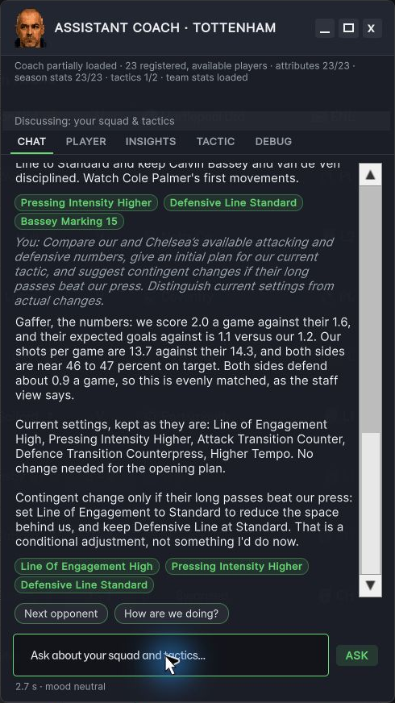
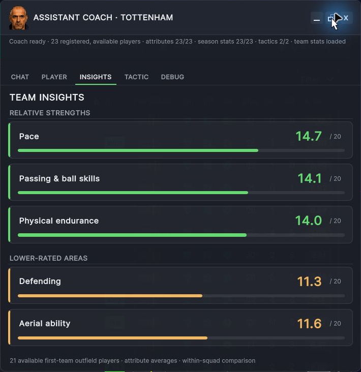
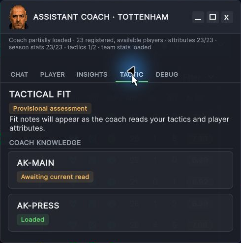
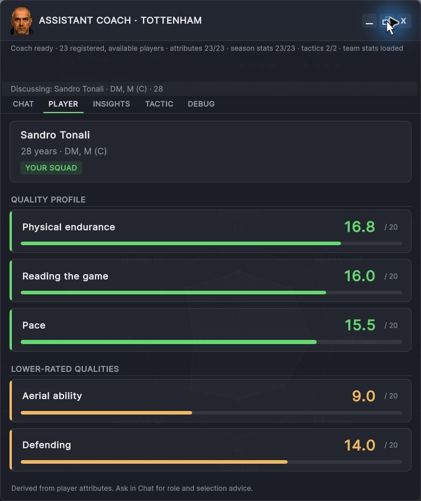

# FM Coach

An in-game assistant coach for Football Manager 27. Talk through your squad, prepare for the next opponent, and assess tactical adjustments without switching between pages to supply the coach with context.

**Version 0.7.30 · Windows · BepInEx 6 / IL2CPP · OpenRouter · [MIT](LICENSE)**

## Meet your number two

| Match preparation | Squad insights |
| --- | --- |
|  |  |
| Tactical fit | Player assessment |
|  |  |

Screenshots show actual gameplay captures cropped to the coach panel. See [capture notes](docs/screenshots/sources.txt).

## What it does

- **Knows your available first team.** Loads registered players at the club, attributes, and current-season club statistics. Includes eligible incoming loans; excludes injured, loaned-out, and unregistered players.
- **Understands your tactics.** Reads formation, mentality, team instructions, both possession-phase roles, and effective player instructions, including default settings.
- **Prepares for the opposition.** Uses available scouting facts and team statistics with their season and competition labels. Gives a provisional plan without requiring hidden opponent roles or instructions; tactical hypotheses stay conditional.
- **Adds interpretation.** Insights and player cards summarize attribute strengths. Tactical fit highlights potential mismatches instead of duplicating FM's instruction tables.
- **Stays advisory.** Reads game bindings and offers recommendations. It does not change your tactic, select players, advance time, or save the game.

## Requirements

- Football Manager 27 on Windows, with a compatible **BepInEx 6 IL2CPP x64** installation. Development testing used `6.0.0-be.791`.
- An OpenRouter API key and an available model configured for chat. Provider usage is billed to your account.
- A compatible game build: FM's internal bindings can change with game updates. This is an experimental community plugin.

Game assemblies and BepInEx binaries are not included in the source repository. See [building from source](docs/DEVELOPMENT.md).

## Install

1. Save your progress and close FM.
2. Install a compatible BepInEx loader separately. Launch FM once so it generates its configuration and interop assemblies, then close it.
3. Place a built `FMCoach.dll` in `<FM27>/BepInEx/plugins/FMCoach/`.
4. Launch and close FM once to create `<FM27>/BepInEx/config/local.fmcoach.poc.cfg`.
5. Create a private text file containing `KEY=your-openrouter-key`. Set `[AI] KeyFile` in the config to its **absolute path**. The default location is `Documents/fmcoach/.key`; never commit this file.
6. Set `[AI] Model` to an available OpenRouter model ID, then launch FM and load your career.

The coach prompt is embedded in the DLL. To customize it, copy [`coach_system_prompt.txt`](coach_system_prompt.txt) to the configured `[AI] PromptFile` path; changes are re-read during the session.

For the default Steam installation, developers can also deploy an explicitly selected DLL while FM is closed:

```powershell
.\deploy-plugin.ps1 -DllPath .\dist\FMCoach.dll
```

`dist/` is a local release output, excluded from Git. Build instructions below produce the DLL; this repository does not require committing compiled binaries.

## Use

Click **COACH** after loading a career. The launcher sits above the bottom action row so FM's Apply and Cancel controls remain accessible. **F10** also toggles the panel where supported.

| Tab | Purpose |
| --- | --- |
| Chat | Ask questions or use context-aware quick questions. Grounded callouts show relevant values. |
| Player | See derived quality cards for the profile currently open in FM. |
| Insights | See squad attribute strengths and lower-rated areas. |
| Tactic | Review tactical-fit notes and each saved plan's knowledge status. |
| Debug | Inspect coverage, refresh data, or create diagnostic dumps. |

Allow the initial snapshot to finish. In the tested career, startup reading took about 88 seconds. The coverage status shows what is loaded and what remains unread.

### Saved tactics: an important limitation

FM Coach discovers up to three saved tactics, but the tested read-only FM bindings return **only the selected tactic**. On a fresh session, open each other saved tactic once in FM so the coach can read it. Two saved plans were verified live; a three-plan career was not available for live testing.

Cached plans are marked and excluded from current factual advice until read in the current session. A cached plan never counts as freshly loaded. The plugin does not silently cycle your game's tactic selection.

### Advice and data

Opponent scouting is naturally incomplete. The coach should give a useful initial plan from what is known, distinguish tendencies from a confirmed match-day setup, and suggest what to observe during the opening exchanges. It can recommend keeping your current approach.

Attribute cards are simple derived averages, **not league rankings**. Goalkeeper skill scores exclude eccentricity, rushing-out and punching tendencies. Generated advice can still contain loose interpretations; verify recommendations against the match and your judgement.

When you send a chat question, the plugin sends career context and recent conversation to **OpenRouter and the configured model provider**. That context can include player attributes, team statistics, tactics and finances. The API key is read from your private file and is not embedded in the DLL. Local debug dumps and snapshots may contain career data; they are excluded from Git.

## Development and verification

```powershell
.\build-plugin.ps1
.\test\review\Run-Regression.ps1
```

The build creates an immutable, version-stamped DLL plus a SHA-256 manifest. The offline suite compiles the current plugin and runs **169 checks** without opening FM or contacting an API. See [development instructions](docs/DEVELOPMENT.md) and [verification notes](docs/VERIFICATION.md) for prerequisites and the limits of these checks.

## Feedback

When reporting an issue, include the plugin version, game version, steps to reproduce, and a cropped screenshot if useful. Review logs and dumps for private career data before sharing them. Never attach API keys, save files, or game assemblies.

Released under the [MIT License](LICENSE). Locally supplied game and loader assemblies are excluded from this repository and are not covered by this project's license.

FM Coach is a community project, not affiliated with Sports Interactive or SEGA.
